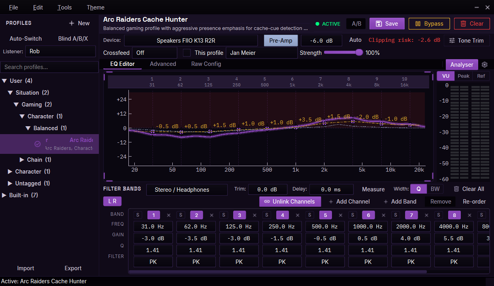
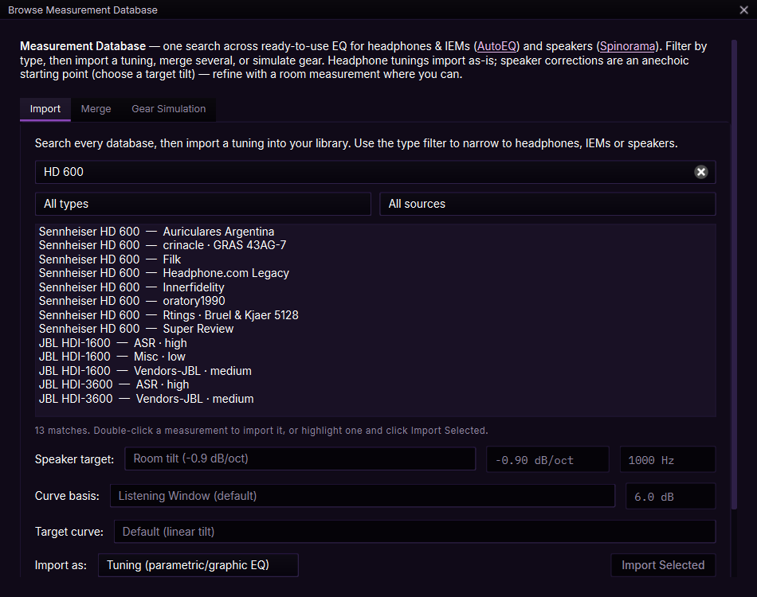
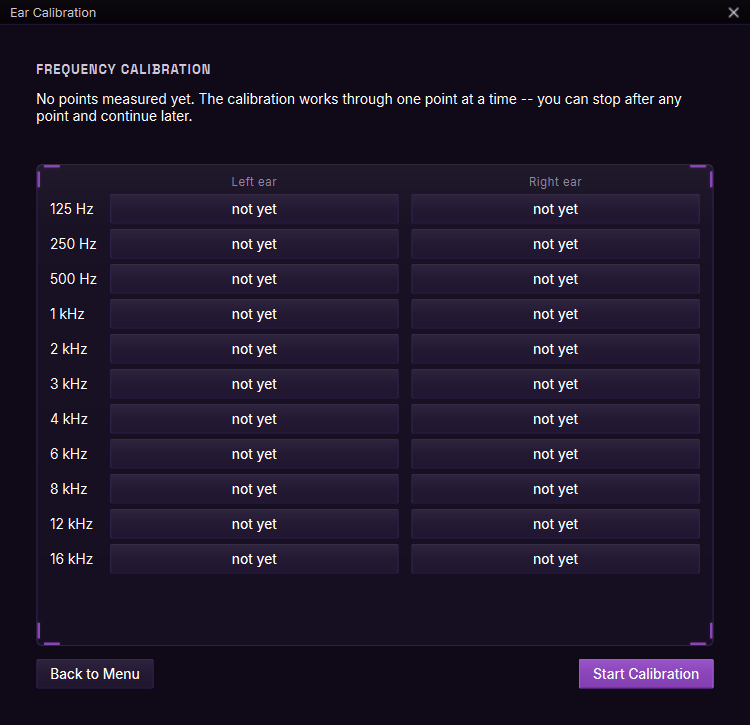
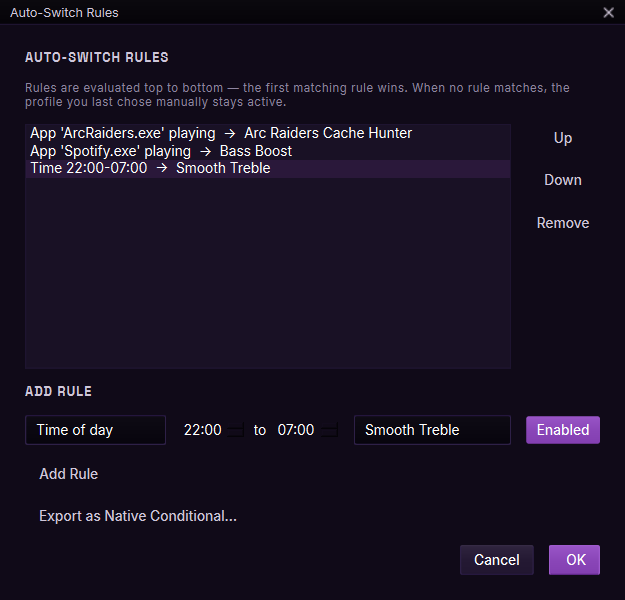

# RUMBLE

A Windows app for building, organising and switching [Equalizer APO](https://sourceforge.net/projects/equalizerapo/) EQ profiles for headphones, IEMs and speakers.

I made RUMBLE because I got fed up hand-editing Equalizer APO's config file every time I wanted to change how something sounded. It started out as a simple profile switcher and grew a fair bit from there. It's a hobby project, built with Claude Code, and it's GPL v3, so if you'd like to change it or build on it, go ahead.

> RUMBLE doesn't install Equalizer APO. That's a separate system-level audio driver you'll need to install yourself (it needs admin rights and a reboot). RUMBLE will point you to its download page.



## Installing

1. Install [Equalizer APO](https://sourceforge.net/projects/equalizerapo/) and tick your playback device in its Configurator, then reboot.
2. Download `RUMBLE-Setup.exe` from the [latest release](https://github.com/D0k-Soundwave/Rumble/releases/latest) and run it. It installs just for you, so it doesn't need admin rights.

The installer isn't code-signed, so Windows SmartScreen may say "Windows protected your PC" the first time. Click **More info**, then **Run anyway**. Each release lists the installer's SHA-256 checksum if you'd like to check the download first.

## What it does

### Profiles

- Keeps all your EQ profiles in one searchable library, grouped automatically by their tags.
- Lets you switch profiles from the system tray without opening the main window.
- Every profile is a normal Equalizer APO config file with a short header on top, so nothing's locked into a RUMBLE-only format.
- Imports plain APO configs, Peace saves, REW filter exports and zip bundles. If you already had an APO config before installing, it'll offer to bring that in as a profile.
- Deleted profiles go to a recycle bin first, and you can back up and restore the whole library in one go.
- Comes with seven starter profiles that aren't tied to any particular hardware.

### Editing

- Parametric EQ with up to 32 bands per profile, covering the standard filter types APO supports (peaking, shelves, low and high-pass, notch, all-pass and so on).
- A live frequency-response graph that updates as you edit.
- A freeform graphic EQ curve you can draw on top of the parametric bands, and conversion between the two.
- Undo and redo, per-channel solo, and A/B comparison while you're editing.
- Auto-preamp, which works out how far to drop the overall level so your boosts don't clip.
- A few more advanced bits for anyone who wants them: per-channel delay, channel routing and mixing, and APO's conditional scripting.

### Measurements and correction

- Search roughly 4,000 measured headphones and IEMs from AutoEQ, plus speaker measurements from Spinorama, then apply a correction in a couple of clicks.
- Choose from a range of named target curves, or average several measurements together.
- Bring in your own room measurements from REW, along with miniDSP/UMIK microphone calibration files.
- Bass management and Linkwitz-Riley crossovers for 2.1 to 5.1 speaker setups, plus speaker time alignment.

### Listening

- **Ear Calibration:** a guided listening routine that builds a personal EQ correction for each ear, on your own hardware. It's a relative measurement for tuning sound, not a medical evaluation. Up to four people can each have their own listener slot.
- Optional loudness compensation that follows your volume level, based on the published ISO 226 equal-loudness curves.
- Headphone crossfeed, with a few classic circuit presets (Chu Moy, Jan Meier, Linkwitz-style) or your own settings.
- A quick bass, treble and tilt trim for those "this track's a bit harsh tonight" moments. It resets each time you start the app, unless you bake it into a profile.
- Optional loudness matching, so a profile doesn't just sound "better" because it happens to be louder.
- A blind A/B/X test with level matching and proper statistics, for when you're honestly not sure you can hear a difference.

### Day to day

- Automatic profile switching by app, output device or time of day.
- Different profiles on different devices at the same time.
- A live spectrum analyser and level meters.
- Keeps an eye on Equalizer APO's config. It backs up your original on first run, notices if another tool overwrites it, and can hand control back to APO whenever you like.
- Warns you if Windows "Audio enhancements" is switched off for a device, which quietly stops APO (and so RUMBLE) from doing anything at all.
- Seven built-in themes, and a theme editor if you'd rather make your own.

### AI-written profiles (optional)

RUMBLE has no AI built in and doesn't connect to any AI service. It does include a couple of ready-made prompts you can paste into whichever assistant you use (ChatGPT, Gemini, a local model, whatever you've got) to help it write a profile RUMBLE can import.

## Screenshots

Searching the measurement database for a headphone, ready to import its correction:



Ear Calibration, measured one frequency and ear at a time:



Auto-switch rules for an app, a music player and a time of day:



## Status

It works, but it's a one-person project, so there'll probably be a few rough edges.

Bug reports and suggestions are welcome, either through GitHub Issues or by email to D0k@Soundwave.Team.

---

## Project layout

```
rumble/            The application — one self-contained package
  __main__.py       Entry point (python -m rumble)
  core/             Profile/APO logic, AutoEQ, audio devices
  ui/               Qt windows, dialogs, glass-HUD theming
  assets/           Bundled fonts, icons, audio, and AI-prompt markdown
  rumble.ico
packaging/         Build recipe (PyInstaller spec, Inno Setup script, build.ps1)
tests/             Regression gate (run_all_tests.py + selftest_*/test_*/verify_*)
tools/             Dev-only utilities (renderers, previews, audits)
docs/              Design & specification documents
data/              Local runtime data (dev only; shipped app writes next to the exe)
```

## Development

```powershell
# from the repo root, in your virtualenv
pip install -e .

python -m rumble                 # run the app
python tests/run_all_tests.py   # run the full regression gate (offscreen)
```

The app reads/writes its data folder next to the executable when frozen, and at
the repo root (`./data`) in development.

## Building the Windows installer

Produces a **per-user, no-administrator** installer (`dist\RUMBLE-Setup.exe`).

Prerequisites:
- The dev dependencies installed (`pip install -e .`) including PyInstaller.
- [Inno Setup 6](https://jrsoftware.org/isdl.php) (provides `ISCC.exe`) for the
  installer step.

```powershell
pwsh packaging\build.ps1                 # exe + installer
pwsh packaging\build.ps1 -SkipInstaller  # just dist\RUMBLE\RUMBLE.exe
```

Stage 1 (PyInstaller, `packaging/rumble.spec`) bundles the app and Python into
`dist\RUMBLE\RUMBLE.exe`. Stage 2 (Inno Setup, `packaging/installer.iss`) wraps it
into `dist\RUMBLE-Setup.exe`, which installs to
`%LOCALAPPDATA%\Programs\RUMBLE`, adds Start-menu/optional desktop shortcuts,
offers an optional link to the Equalizer APO download page, and uninstalls
cleanly (removing the install folder, the per-user autostart entry, and RUMBLE's
footprint inside the APO config tree).
